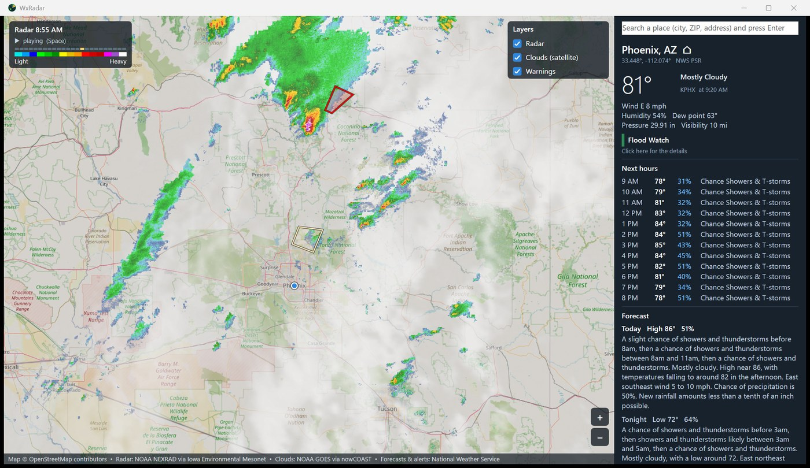

# WxRadar

A weather radar app for Windows: the live NOAA radar loop over a map, the
National Weather Service's warnings and forecasts, and satellite clouds.
**No ads, no tracking, no account, no data collection.** Everything comes
straight from free public sources, and the app keeps nothing about you except
its own settings file.



## Features

- **Radar loop.** The last two hours of NOAA NEXRAD radar, played smoothly.
  WxRadar works out how the storms are moving and draws true in-between
  pictures, so rain moves across the map instead of jumping every 5 minutes.
  When zoomed in, the radar is smoothed rather than shown as blocky squares.
- **Satellite clouds.** NOAA GOES infrared imagery, day and night, as
  see-through clouds over the map. They move smoothly too, with a motion of
  their own (clouds ride the winds higher up than the storms below).
- **Warnings.** NWS tornado, severe thunderstorm, flash flood and other
  storm-based warnings drawn on the map; click one for its full text.
- **Forecasts.** Current conditions from the nearest weather station, the next
  hours, and the 7-day forecast from the National Weather Service, for your
  home or any point you pick. Alerts in effect there are listed too.
- **Layers.** Turn radar, clouds and warnings on or off.
- **Search** for a city, ZIP code or address.

## Using it

Download `WxRadar.exe` from the [Releases](../../releases) page and run it.
It is a single program with no installer and no runtime to install (Windows
10 or 11).

- Drag the map to move it; zoom with the mouse wheel, double-click, or the
  **+** / **−** buttons.
- Right-click the map for **Forecast here**, **Make this my home**, the radar's
  opacity and more.
- Click a warning on the map, or an alert in the side panel, to read it.
- Keys: **Space** play or pause, **←** **→** step through the loop, **+** **−**
  zoom, **Home** go home, **F5** refresh.

On first start WxRadar asks Windows where you are (only if Windows location is
turned on) to set your home; you can also set it with a right-click or the
search box. Forecasts and warnings cover the United States and its
territories, which is what the National Weather Service serves.

## Where the data comes from

| What | Source |
|---|---|
| Radar | NOAA NEXRAD composite reflectivity, as map tiles from the [Iowa Environmental Mesonet](https://mesonet.agron.iastate.edu/) (Iowa State University) |
| Clouds | NOAA GOES East and West longwave infrared, from NOAA [nowCOAST](https://nowcoast.noaa.gov/) |
| Forecasts, observations, alerts | The National Weather Service API, [api.weather.gov](https://www.weather.gov/documentation/services-web-api) |
| Map | [OpenStreetMap](https://www.openstreetmap.org/copyright) contributors |
| Place search | OpenStreetMap [Nominatim](https://nominatim.org/) |

None of these need an account or a key. WxRadar identifies itself to them as
`WxRadar/1.1` with a link to this page, as they ask; it sends them only what
it needs (a map area, or a point for a forecast or search).

**Map tiles.** By default the map comes from OpenStreetMap's own tile server,
which is run by volunteers; its [usage policy](https://operations.osmfoundation.org/policies/tiles/)
allows apps like this in moderation. WxRadar keeps the tiles it has downloaded
for a week. To use another tile service (for example one with a free key of
your own), add these lines to `%APPDATA%\WxRadar\WxRadar.ini`:

```
MapTiles=https://your.tile.server/{z}/{x}/{y}.png
MapCredit=Map © its owners
```

## Your settings

WxRadar keeps its settings (your home, the view, the layers) in
`%APPDATA%\WxRadar\WxRadar.ini` and downloaded map tiles in
`%LOCALAPPDATA%\WxRadar\tiles`. Nothing else is stored, and nothing is sent
anywhere except the data requests above.

## Building

Visual Studio 2019 or later with the C++ desktop workload, and CMake:

```
cmake -S . -B build -G "Visual Studio 16 2019" -A x64
cmake --build build --config Release
```

The program is `build\Release\WxRadar.exe`. It is plain C++17 with Win32,
Direct2D, DirectWrite, WinHTTP and WIC, all part of Windows: no other
libraries.

## License

MIT - see [LICENSE](LICENSE). The data sources have their own terms (see the
table above): OpenStreetMap data is © OpenStreetMap contributors under the
ODbL, and the NOAA/NWS data is public domain.
